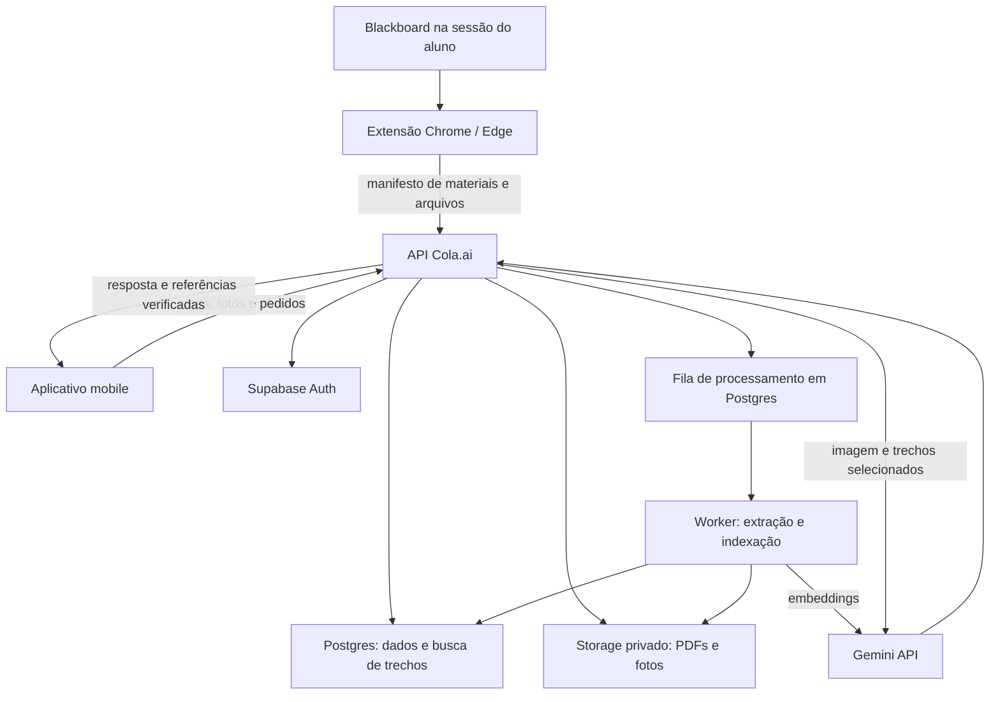

# Cola.ai — arquitetura proposta

Status: proposta para o projeto do semestre; serviços externos ainda não provisionados.
Integrantes: Manoel Rodrigues e Uilsom Cardoso.
Tecnologia mobile provisória: React Native com Expo e TypeScript. A disciplina ainda não definiu exigências.

## Fase 2: prioridade corrigida

O resumo geral com leitura de todo o acervo importado é requisito inicial, junto da importação de disciplina. Não depende de busca por pergunta ou embeddings. Desenho concreto, contratos, cobertura, custos e primeiro experimento em [FASE-2-RESUMO-GERAL.md](FASE-2-RESUMO-GERAL.md), proposta de 15/11/2026 ainda sujeita a alinhamento.

## Produto e experiência

Aplicativo mobile para responder questões por foto, revisar conteúdos, analisar provas corrigidas e gerar simulados com fontes dos materiais da disciplina. A importação do Blackboard ocorre por extensão no computador; depois da sincronização, o acervo fica disponível no celular. Não existe sincronização contínua com o Blackboard nem importação mobile validada nesta etapa.

O aluno entra no Cola.ai, conecta a extensão à mesma conta, importa disciplinas e materiais no navegador e os encontra no aplicativo. No dia a dia, seleciona uma matéria e usa câmera, revisão ou simulado. Não precisa cadastrar as matérias importadas manualmente.

## Componentes



### Decisões de tecnologia

- Mobile: React Native + Expo + TypeScript, provisoriamente. Um aplicativo para Android e iOS; a primeira homologação pode ser feita em Android.
- Extensão: Manifest V3, migrando o código atual gradualmente para TypeScript. PDF.js empacotado localmente para a prévia e extração local; sem JavaScript remoto.
- API: Node.js + TypeScript, HTTP/JSON. Único lugar para operações de IA, regras de importação e pontuação. Um monólito modular, sem microsserviços iniciais.
- Supabase: Auth para identidade; Postgres para dados; Storage privado para arquivos. Políticas de acesso por proprietário nas tabelas e objetos.
- Busca: trechos com embeddings no Postgres/pgvector, combinados com busca textual. Escolha do modelo e dimensão dos embeddings será validada antes de criar o índice.
- Worker Node separado do processo HTTP, reutilizando módulos do servidor. Tarefas duráveis em Postgres com retentativas limitadas; não depender do popup aberto.
- Gemini API no servidor: leitura das imagens, explicações e geração de conteúdo. Google AI Studio para experimentar prompts e avaliações. Modelo configurável por ambiente, sem fixar uma versão antes de medir custo, qualidade e latência.
- Alternativa considerada: Gemini File Search gerenciado. Não é o padrão inicial para manter o controle da busca, isolamento e referências por página já extraídas. Evitar operar duas bases RAG paralelas no MVP.

## Módulos

1. Identidade e dispositivos: conta, sessões, pareamento da extensão.
2. Integração Blackboard: descoberta de disciplinas, travessia de pastas, seleção e importação.
3. Acervo: matérias, documentos, versões, páginas, provas e fontes.
4. IA acadêmica: resolução por foto, conversa por disciplina, revisão e análise de correções.
5. Simulados: geração, tentativas, respostas e explicações.
6. Gamificação: eventos de XP, níveis e prevenção de duplicidade.

## Importação e sincronização

1. Extensão é pareada à conta por código de uso único, curto prazo e confirmação no aplicativo. O servidor emite credencial revogável restrita à importação, armazenada localmente na extensão. Nunca transportar sessão por parâmetro de URL.
2. Aluno abre o Blackboard e solicita a importação. O importador percorre somente conteúdos que ele consegue acessar; respeita indisponibilidades.
3. Descoberta de pastas e arquivos usa DOM e controles de navegação observados. Travessia iterativa com espera, profundidade máxima, conjunto de itens visitados, cancelamento e relatório de falhas. Implementar seletores após observar páginas reais. Não pressupor APIs internas estáveis.
4. Lista virtualizada exige rolagem e coleta incremental. Não há garantia de completude só porque não surgiram itens numa única passagem. Relatório distingue concluído, parcial e interrompido.
5. Disciplina recebe chave externa composta por instância Blackboard + ID do curso. Arquivo mantém ID de conteúdo e hash SHA-256. Reimportar a mesma versão não duplica dados.
6. API recebe manifesto e decide quais versões faltam. Extensão obtém os PDFs na sessão local e usa upload autorizado e limitado pelo servidor.
7. Não enviar cookies, senhas, tokens do Blackboard ou URLs assinadas ao servidor. O backend não busca endereços arbitrários do Blackboard.
8. Servidor valida tamanho, assinatura, hash, propriedade e formato dos dados. O PDF original é a fonte canônica; texto do cliente é prévia não confiável e deve ser reextraído/validado pelo worker.
9. Uploads parciais podem ser retomados por arquivo. Retry é idempotente. Atualização é iniciada pelo aluno; mostrar data da última importação. Não excluir materiais automaticamente porque sumiram de uma captura parcial.
10. Worker extrai páginas, detecta páginas sem texto, divide em trechos, gera embeddings e torna o documento consultável. Falhas não bloqueiam os outros arquivos.

Persistência local da fila na extensão e tarefas no servidor evitam perda de progresso. Credenciais e documentos são removidos no desligamento da conta conforme a política do produto.

## Fluxo de resposta por foto

1. Selecionar disciplina; fotografar uma ou mais questões.
2. Validar tamanho e qualidade; armazenar imagem em área privada.
3. Modelo transcreve enunciado e alternativas; se houver ambiguidade, pedir confirmação ou nova foto. Manter enunciado reconhecido acessível para correção pelo aluno.
4. Servidor busca trechos apenas nos materiais ativos daquele aluno e daquela disciplina.
5. Modelo recebe imagem, pergunta e trechos identificados e produz resposta estruturada por questão.
6. Backend aceita referências somente aos trechos enviados. Referências inexistentes são rejeitadas; se necessário, nova tentativa limitada ou resposta sem fundamentação local.
7. Aplicativo mostra resposta, explicação, arquivo e página. Ao tocar, abre o PDF armazenado, mesmo que o link temporário do Blackboard expire.
8. Se o acervo não sustenta a resposta, exibir essa ausência. Uma resposta baseada em conhecimento geral deve ser identificada como tal. Citação válida não garante raciocínio correto: testar também a sustentação da resposta.

Materiais e imagens são dados, não instruções de sistema. A IA não executa ações nem modifica acervo com base em comandos contidos nos PDFs.

## Modelo de dados

Todas as entidades de aluno possuem owner_id ou vínculo verificável com o proprietário. Identificadores enviados pelo cliente não substituem autorização.

| Entidade | Conteúdo e relações principais |
|---|---|
| profiles | Usuário autenticado, nome e preferências |
| extension_devices | Proprietário, credencial armazenada como hash, escopo e revogação |
| courses | Proprietário, nome, origem, instância e ID externo |
| import_runs | Dispositivo, disciplina, status, contagens e falhas sem segredos |
| documents | Disciplina, título, tipo (material/prova), ID externo e versão ativa |
| document_versions | Documento, SHA-256, caminho privado, tamanho, status e versão do extrator |
| pages | Versão, número da página, texto e situação de extração/OCR |
| chunks | Versão, páginas inicial/final, texto e embedding |
| processing_jobs | Versão, etapa, tentativas, prazo de execução e erro sanitizado |
| sessions | Disciplina, modo (foto/revisão/correção) e estado |
| messages | Sessão, entrada, saída e modelo utilizado |
| citations | Mensagem, trecho e referência estável de versão/página |
| assessments | Disciplina, fotos da prova, condição de correção e sessão de análise |
| quizzes / quiz_questions | Disciplina, questões geradas, gabarito, explicações e referências |
| quiz_attempts / answers | Tentativa, resposta do aluno e resultado |
| xp_events | Proprietário, ação, pontos, entidade de origem e chave única de idempotência |

Unicidade: disciplina por proprietário + origem + instância + ID externo; versão por documento + hash; página por versão + número; evento XP por proprietário + ação + entidade. Hash não permite descobrir documentos de outros usuários.

## Contratos HTTP iniciais

| Rota | Finalidade |
|---|---|
| POST /v1/device-pairings | Iniciar pareamento com expiração |
| POST /v1/device-pairings/:id/approve | Confirmar vínculo pela sessão do aluno |
| POST /v1/device-pairings/:id/exchange | Trocar prova de posse por credencial de importação |
| POST /v1/imports | Receber manifesto e retornar arquivos faltantes |
| POST /v1/imports/:id/uploads | Autorizar upload com limites e caminho definidos pelo servidor |
| POST /v1/imports/:id/complete | Confirmar recebimento e enfileirar processamento |
| GET /v1/imports/:id | Consultar progresso e falhas |
| GET /v1/courses | Listar disciplinas do aluno |
| GET /v1/courses/:id/documents | Listar acervo e situação de processamento |
| POST /v1/courses/:id/photo-sessions | Criar análise por foto |
| POST /v1/sessions/:id/messages | Perguntar ou corrigir transcrição |
| GET /v1/sessions/:id | Consultar resultado e fontes |
| POST /v1/courses/:id/quizzes | Solicitar simulado |
| POST /v1/quiz-attempts/:id/answers | Registrar resposta |
| DELETE /v1/documents/:id | Solicitar exclusão de arquivo e dados derivados |

Uploads e tarefas usam IDs e chaves idempotentes. Operações longas retornam ID e status; inicialmente o cliente consulta por polling. Paginação nas listagens. Limites de foto, texto e requisições aplicados no servidor.

## Telas mobile

- Entrada e conta.
- Início: disciplinas importadas, última sincronização e acesso rápido à câmera.
- Disciplina: materiais, conversa, revisão e simulados.
- Captura: foto, recorte/qualidade e confirmação do enunciado quando necessário.
- Resultado: questões, explicações e fontes navegáveis.
- Provas: histórico e análise das correções.
- Simulado: questões, resultado e revisão dos erros.
- Perfil: XP, níveis, dispositivos conectados e exclusão de dados.

## XP

Manter a hierarquia proposta: simulado gera pouco XP; prova corrigida, XP intermediário; uso de foto durante prova, XP alto. Valores numéricos ainda serão definidos. Pontuação é calculada no servidor, concedida por evento concluído e limitada por período. A mesma prova não rende pontos repetidos. Sem integração de fiscalização, o sistema não consegue provar que uma foto foi tirada durante uma avaliação: essa categoria será autodeclarada, sem prometer verificação.

## Segurança e operação

- Chave Gemini e chave administrativa do banco apenas no servidor/worker. Aplicativo usa sessão do próprio aluno.
- Auth e autorização testadas em dados e armazenamento. Acervo privado por aluno no MVP; compartilhamento por turma fica fora do primeiro escopo.
- URLs temporárias para leitura de arquivos privados. Logs sem fotos, texto completo, cookies ou URLs assinadas.
- Exclusão de documento remove páginas, trechos, embeddings e objeto; referências históricas ficam marcadas como fonte removida.
- Cotas de uso, limite de concorrência e registro de consumo por operação. Estimar custos com medidas reais; não prometer gratuidade.
- Erros independentes por arquivo, retentativa limitada, identificação de trabalhos presos e versão do pipeline para reprocessar.
- Falta de rede permite consultar apenas o que tiver sido explicitamente armazenado em cache; respostas de IA exigem conexão.

## Organização do repositório futuro

```text
apps/mobile/          aplicativo Expo
apps/extension/       extensão atual migrada sem perder funcionalidades
apps/api/             API HTTP
apps/worker/          processamento assíncrono
packages/contracts/   esquemas, tipos e validação
packages/ai/          prompts, respostas estruturadas e busca
supabase/migrations/  banco e políticas
 tests/               integração, isolamento e qualidade
 docs/                arquitetura e decisões
```

Manter a prova de conceito atual utilizável até concluir a migração. Não misturar PDFs pessoais ou diagnósticos reais em fixtures públicas. Segredos por ambiente e arquivos de exemplo sem valores reais.

## Etapas e critérios de conclusão

1. Validar localmente o resumo geral com o JSON completo já importado, antes do app: comparar leitura integral e hierárquica, conferir cobertura e referências, medir custo e qualidade. Seguir o desenho da fase 2 após alinhamento.
2. Fundação persistente: Auth, banco, Storage, API e worker; importação de todos os materiais descobertos da disciplina, com falhas e cobertura da descoberta explícitas. Reimportação idempotente, isolamento entre usuários e acesso ao original.
3. Resumo geral integrado: uma ação, job durável, todos os documentos do snapshot contabilizados, referências por versão/página, recuperação de falhas e atualização incremental.
4. Aplicativo mobile: disciplinas, materiais e resumo geral navegável. Tecnologia mobile ainda provisória.
5. Busca/indexação e resolução por foto: trechos para perguntas, transcrição, fontes e ausência de sustentação sinalizada.
6. Revisão de provas corrigidas, simulados e XP.
7. Apresentação: demonstração em celular e evidências de qualidade, custo e limitações.

O primeiro fluxo de produto inclui importação da disciplina e resumo geral. Busca vetorial não é pré-requisito para esse resumo. Afirmar importação completa do Blackboard exige validação adicional da descoberta.

## Evidência já obtida e pendências

Extensão Manifest V3 0.4.0: varredura relatada abriu 14 controles sem falhas e encontrou 19 PDFs e 8 avaliações. Lote real conferido em 15/11/2026: 19 PDFs concluídos, **445 páginas**, 217.042 caracteres, zero páginas marcadas para OCR e numeração consistente. Avaliações não entram no lote. `processingComplete: true` não altera `coverage: nao-confirmada` da descoberta. Imagens e diagramas não têm compreensão garantida pela extração textual.

Ainda não implementados: backend, conta Cola.ai, sincronização com servidor, armazenamento persistente, resumo via Gemini, busca vetorial, aplicativo mobile e XP. Travessia e lote locais já foram exercitados; completude de descoberta ainda não confirmada. Outros formatos, documentos escaneados e PDFs protegidos exigem testes próprios.

## Referências técnicas

- https://supabase.com/docs/guides/auth/quickstarts/react-native
- https://supabase.com/docs/guides/storage/security/access-control
- https://supabase.com/docs/guides/auth
- https://ai.google.dev/gemini-api/docs/file-search
- https://developer.chrome.com/docs/extensions/develop/concepts/network-requests
- https://mozilla.github.io/pdf.js/examples/
