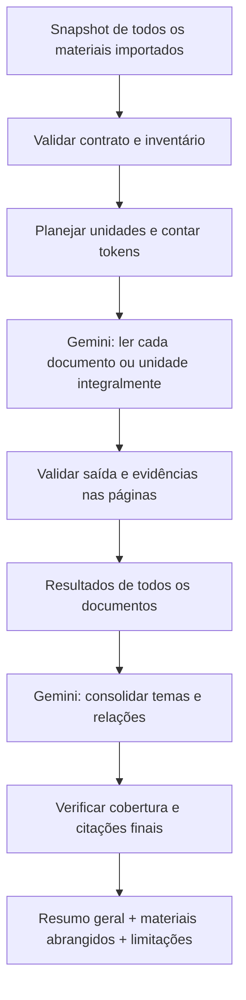

# Fase 2 — resumo geral com cobertura e referências

Data: 15/11/2026. Status: desenho proposto para alinhamento; não autoriza implementação nem provisionamento. Nenhuma chamada ao Gemini foi feita nesta etapa.

## Escopo e experiência

Uma ação do aluno: **Gerar resumo geral**. O sistema percorre todos os materiais do snapshot importado, organiza os temas e entrega um resumo consolidado com referências por arquivo e página. Divisão, retentativas e consolidação são internas. Não depende de pergunta, embeddings ou seleção dos trechos mais próximos de uma consulta.

“Todo o acervo importado foi processado” e “todo o Blackboard foi descoberto” são afirmações diferentes. Mesmo com processamento de 100% do lote, a cobertura da origem continua não confirmada se a descoberta não foi validada. Um resumo comprime conteúdo: processar todas as páginas não significa reproduzir cada informação.

## Base real conferida

JSON local validado: `schemaVersion: 1`, `source: blackboard-batch`, 19 arquivos concluídos, **445 páginas**, 217.042 caracteres, zero páginas marcadas para OCR, `processingComplete: true` e `coverage: nao-confirmada`. Descoberta sem falhas registradas, encerrada por ausência de novos itens observados. A varredura relatada abriu 14 controles e encontrou também 8 avaliações; estas não fazem parte do lote de PDFs.

O JSON tem texto por página, nome, hash e página de origem; não contém o PDF binário nem caminho de pasta estruturado. Consequências:

- O primeiro teste pode validar resumo textual e referências ao texto extraído, sem backend/mobile.
- Não pode demonstrar compreensão de diagramas nem abertura do PDF original apenas com esse JSON.
- Não inferir pastas a partir de nomes/URLs. O importador deverá futuramente acrescentar IDs de conteúdo, `folderPath` e inventário dos itens descobertos e não suportados, mantendo compatibilidade com schema 1.
- A ausência de `needsOcr` não garante fidelidade visual, ordem de leitura, fórmulas ou tabelas.

Acervo, nomes reais e textos ficam fora desta documentação e de fixtures públicas. O arquivo foi lido como dados.

## Decisões propostas

| Questão | Proposta | Motivo |
|---|---|---|
| Execução | Job assíncrono, HTTP 202 e polling | Sobrevive a fechamento da tela e permite retomar falhas |
| Leitura | Processamento exaustivo por documento, subdividindo apenas quando necessário | Cobertura auditável e reaproveitamento em atualizações |
| Consolidação | Síntese por temas a partir dos resultados de todos os documentos | Entrega um resumo de disciplina, sem exigir ações por arquivo |
| Chamada integral | Comparador no experimento; possível otimização futura | Contexto disponível não comprova cobertura semântica |
| Busca vetorial/File Search | Fora da dependência deste módulo | Recuperação por relevância não assegura leitura exaustiva |
| Fonte de referência | Versão imutável + página física + evidência textual | Referência estável e verificável |
| Persistência | Postgres para jobs/resultado; Storage privado para originais | Integra-se ao desenho geral sem novos microsserviços |
| Entrada inicial | JSON local textual | Teste independente do app e de contas/Supabase |
| Modelo candidato | `gemini-3.8-flash`, configurável e sujeito a avaliação | Versão estável documentada; não fixar modelo antigo por hábito |

## Pipeline concreto



1. Congelar snapshot da disciplina e criar manifesto determinístico de versões, páginas e hashes de texto. Ordenação estável; registrar prompt, pipeline e modelo. Nenhuma URL assinada vai ao modelo.
2. Validar limites, tipos, hashes declarados, páginas únicas e contagem consistente. Sem binário, o SHA-256 do PDF é apenas declarado pelo cliente; calcular hash próprio do texto canônico. Não afirmar validação do original.
3. Planejar unidades que, em conjunto, contenham todas as páginas/textos esperados. Inicialmente um documento por unidade, até 20 mil tokens de fonte por unidade, alvo de engenharia ajustável. Documentos maiores são divididos em fronteiras de páginas/seções; página enorme pode ser dividida em intervalos de texto, preservando offsets. Nunca cortar silenciosamente.
4. Contar o payload completo com `countTokens` antes de gerar. Respeitar limite de entrada, limite de saída e orçamento próprio. Não usar número de caracteres como medição de tokens. No piloto: concorrência 2, ajustável às cotas reais do projeto; iniciar menor se necessário.
5. Cada unidade retorna temas, conceitos, explicações, exemplos, divergências e evidências por página. Também registra páginas sem contribuição, com motivo. Metadados de páginas enviadas são calculados pelo orquestrador, nunca aceitos apenas porque o modelo declarou ter lido tudo.
6. Validar JSON e evidências. Resultado inválido ou truncado não conta como unidade concluída; permitir uma tentativa de reparo, depois subdividir ou registrar falha.
7. Unir unidades de cada documento mantendo conceitos e evidências. Para o lote atual, se cada documento couber, serão 19 análises e uma consolidação, antes de reparos/verificação. Na consolidação, fornecer todos os resultados e o inventário, sem seleção top-k. Se exceder orçamento, consolidar em níveis com linhagem de IDs em cada nível.
8. O resumo final organiza temas e relações, preserva contradições entre materiais e incorpora a contribuição de cada documento ou justifica redundância. Evidências citadas passam intactas pelas etapas. Se faltar sustentação, reler as páginas pertinentes antes de aceitar a afirmação; isso complementa a leitura exaustiva inicial.
9. Montar o resultado publicado somente após validação. Resumo anterior permanece disponível durante regeneração. Não publicar saída em streaming como se já estivesse validada.

## Contrato de entrada e saída

O adaptador de schema 1 recebe o JSON existente e converte para o contrato interno abaixo. O contrato de produção também exige vínculo de proprietário, curso e versões persistidas; o cliente não escolhe livremente `ownerId`.

```text
SummaryInputV1
  courseId, snapshotId
  sourceCoverage: confirmed | unconfirmed | partial
  discoveryFailures[]
  documents[]
    documentId, versionId, name, declaredPdfSha256?
    canonicalTextHash, folderPath? (null quando desconhecido)
    pages[]: pageNumber (1-based), text, textHash, needsOcr
    originalAssetId? (null no teste textual)
  excludedItems[]: id, type, reason
```

Todos os itens do snapshot aparecem no inventário: sucesso, falha ou exclusão explícita. Arquivos com erro continuam no denominador. Um snapshot não é formado apenas pelos sucessos.

```text
SummaryResultV1
  summaryId, snapshotId, status, generatedAt
  model, promptVersion, pipelineVersion, inputMode
  overview
  sections[]: id, title, claims[]
    claim: id, text, evidenceIds[]
  evidence[]
    id, documentId, versionId, pageNumber, startOffset, endOffset, quote
  documentCoverage[]
    versionId, expectedPages, submittedPages, validatedPages
    unitIds[], contributedSectionIds[], disposition, reason?
  limitations[]
  coverage
    sourceDiscovery, importedDocumentsExpected, documentsValidated
    pagesExpected, pagesSubmitted, pagesValidated, failedUnits[]
  usage: inputTokens, outputTokens, thinkingTokens?, estimatedCostUsd
```

`quote` é evidência curta do acervo privado, não texto inventado. Offsets referem-se ao texto canônico versionado. Validador localiza a citação no texto e calcula offsets; não confiar em números produzidos pelo modelo. Normalização para localizar evidência deve manter mapeamento ao texto canônico.

`submittedPages` demonstra envio; `validatedPages` significa que as unidades correspondentes passaram pela validação técnica. Nenhum desses contadores prova compreensão de cada detalhe. Cobertura semântica é avaliada separadamente.

## Referências verificáveis

Cada afirmação factual do resumo deve ter uma ou mais evidências; títulos e frases organizacionais dispensam fonte. A consolidação referencia apenas IDs de evidência existentes. Backend verifica autorização, snapshot/versão, página e ocorrência do trecho. Uma citação existente ainda pode não sustentar a afirmação: revisão semântica e avaliação humana continuam necessárias.

UI exibe nome do arquivo e página física do PDF (índice começando em 1); número impresso pode ser metadado separado. Ao abrir, resolver `versionId` para URL temporária do Storage privado e navegar à página. URL do Blackboard serve apenas como origem auxiliar, não como chave ou destino permanente. No piloto textual, abrir a página de texto exportada é suficiente para auditar; abertura do PDF só será validada quando houver original local/persistido.

Não colocar uma referência genérica ao documento para cobrir um parágrafo inteiro com fatos sem sustentação. Para relações entre documentos, manter evidências de ambos. Material duplicado pode compartilhar processamento, mas cada ocorrência permanece contabilizada no inventário.

## Estados, falhas e recuperação

Job: `queued → validating → planning → analyzing → consolidating → verifying → completed`. Saídas alternativas: `completed_with_gaps`, `failed`, `cancelled`. Progresso representa unidades/páginas verificadas, não tempo estimado inventado.

- 429/5xx/timeouts: backoff com jitter, respeitar Retry-After e limitar a três tentativas de transporte por unidade. Reparo semântico tem orçamento separado e limitado. Não repetir todo o lote.
- Lease no worker, heartbeat e chave única por etapa evitam duplicação concorrente. Timeout pode ter sido faturado pelo provedor; registrar tentativas e não prometer execução exatamente uma vez.
- Falha de uma unidade permite continuar as outras; publicação fica marcada com lacunas. Não reduzir denominador para aparentar 100%.
- Sem texto/OCR pendente: registrar lacuna; no piloto não fingir leitura visual. Na evolução, enviar PDF/página ao modelo multimodal ou OCR e validar novamente.
- Cancelamento impede novas chamadas; chamada em andamento pode concluir e gerar custo.
- Descoberta não confirmada não impede gerar o resumo. UI: “19/19 PDFs importados processados. A descoberta de todos os conteúdos do Blackboard ainda não foi confirmada.”
- Se houver falhas de processamento, usar “Resumo com lacunas”, listar documentos/páginas e oferecer retomar. Avaliações ficam explicitamente fora do escopo atual.

## API e persistência futuras

| Operação | Contrato |
|---|---|
| POST `/v1/courses/:id/summary-jobs` | Body `{snapshotId, optionsVersion}` + Idempotency-Key; retorna 202 `{jobId,status,statusUrl}` |
| GET `/v1/summary-jobs/:id` | Estado, fase, contadores, falhas, summaryId quando pronto |
| POST `/v1/summary-jobs/:id/retry` | Retoma apenas unidades elegíveis, mantendo histórico |
| POST `/v1/summary-jobs/:id/cancel` | Solicita cancelamento |
| GET `/v1/courses/:id/summaries/latest` | Último resultado válido e indicação de desatualizado |
| GET `/v1/summaries/:id` | Resultado imutável com cobertura e referências |

Payload inválido: 422; recurso de outro usuário: 404; snapshot ainda incompleto: 409; falta de cota do produto: erro explícito antes de gerar. Não iniciar job em importação ainda em mutação. Importação concluída com falhas pode originar snapshot parcial, com essas falhas preservadas.

Tabelas adicionais propostas: `course_snapshots`, `snapshot_documents`, `summary_jobs`, `summary_units`, `document_summaries`, `course_summaries`, `summary_evidence`, `summary_usage`. Reaproveitar `processing_jobs` como fila durável. Guardar resultado estruturado, linhagem, hashes, estado e consumo; não registrar texto bruto em logs operacionais.

## Atualização dos materiais

Chave de reaproveitamento por proprietário + hash do texto/conteúdo + versão do extrator + modalidade + prompt/schema + modelo/configuração. Não compartilhar cache entre alunos inicialmente. Hash do PDF sozinho não substitui identidade do documento ou autorização.

Reimportação idêntica retorna resultado existente. Documento alterado reprocessa suas unidades e invalida a consolidação. Material novo é incluído automaticamente no próximo snapshot; material ausente em captura parcial não é removido. Exclusão explícita ou inventário confirmado pode desativá-lo. Resumo existente mantém snapshot antigo e selo “Há materiais novos”; não alterar citações históricas para apontar a versão nova. Remoção definitiva da fonte deve invalidar ou remover derivados conforme a exclusão solicitada.

## Gemini, limites e custo

Consulta à documentação oficial em 15/11/2026:

- Candidato `gemini-3.8-flash`: estável, entrada 1.048.576 tokens, saída 65.536; texto/PDF e saída estruturada suportados. Confirmar acesso no projeto antes do teste. O modelo é candidato, não decisão de qualidade já validada. [Modelo](https://aistudio.google.com/docs/models/gemini-3.8-flash).
- Preço Standard consultado: US$ 0,75/1M tokens de entrada e US$ 3,75/1M de saída, incluindo pensamento, até 31/12/2026. A tabela anuncia US$ 1,50 e US$ 7,50 a partir de 01/01/2027. Registrar data/tabela e revalidar antes da execução. [Preços](https://aistudio.google.com/docs/pricing#gemini-3.8-flash).
- A tabela distingue uso de dados entre Free e Paid; para acervo pessoal, a proposta é Paid, após conferir termos aplicáveis. Não pressupor chave ou faturamento existente. [Preços e política indicada](https://aistudio.google.com/docs/pricing).
- Medir entrada com `countTokens` e reconciliar com uso retornado; reservar orçamento de saída e pensamento. [Tokens](https://aistudio.google.com/docs/tokens).
- Saída estruturada facilita validar formato; o servidor ainda valida o significado e as referências. [Structured outputs](https://aistudio.google.com/docs/structured-output).
- Se adotados PDFs, observar limite documentado de 50 MB/1.000 páginas e contexto do modelo. Files API é transporte temporário, com exclusão automática em 48 h, não arquivo permanente do produto. [PDFs](https://ai.google.dev/gemini-api/docs/document-processing), [Files API](https://aistudio.google.com/docs/files).

217.042 caracteres sugerem aproximadamente 54 mil tokens pela regra grosseira de quatro caracteres/token; português, marcadores e schemas alteram isso. Não foi executado `countTokens`. Portanto, a chamada integral textual parece viável, ainda não está comprovada por medição.

Fórmula: soma de todas as entradas × preço de entrada + soma de todas as saídas faturáveis × preço de saída, divididos por 1 milhão. Incluir análises, consolidações, verificação e retries; não apenas a resposta final.

Exemplo de planejamento, não orçamento medido: 100 mil tokens de entrada acumulada e 30 mil de saída faturável custariam US$ 0,1875 nos preços promocionais consultados; US$ 0,375 com as tarifas anunciadas para janeiro. Sem câmbio, Storage ou infraestrutura. Uma chamada de 60 mil de entrada e 8 mil de saída custaria US$ 0,075 nas tarifas atuais. Esses volumes são hipóteses para comparar estratégias.

Proposta de teto inicial do experimento: US$ 1 para as duas variantes somadas, com reserva por chamada e interrupção antes de exceder o teto. Se a medição exigir mais, rever o plano antes de enviar. Sem cache explícito ou Batch API inicialmente: o job assíncrono do produto pode chamar a API normal. Cotas de requisições/tokens serão verificadas no projeto, não inferidas da janela de contexto.

## Primeiro experimento, após alinhamento

Não precisa de Expo, Supabase, pareamento ou deploy. Uma futura ferramenta local Node/TS recebe o caminho do JSON e gera artefatos privados em diretório ignorado pelo Git. Chave por variável de ambiente; jamais em extensão/mobile ou no arquivo do acervo.

1. Validar o lote e gerar manifesto privado com IDs sintéticos, páginas, hashes e contadores; montar inventário de temas esperado por revisão humana de cada documento.
2. Confirmar modelo disponível, credencial e modalidade de uso. Contar payloads e apresentar estimativa dentro do teto combinado.
3. Variante A: uma chamada com todo o texto, delimitadores de documento/página e contrato de evidências/cobertura.
4. Variante B: leitura exaustiva por documento/unidade e consolidação. Mesmo objetivo, idioma, esquema de resultado e critério de avaliação.
5. Salvar respostas, uso, latência, contagem de tentativas e relatório de referências. Nada vai para fixture ou repositório público.
6. Comparar completude temática, qualidade didática, sustentação, repetições, custo e tempo. Não escolher só pela resposta mais fluente.

Critérios de aceite propostos:

- 19/19 arquivos e 445/445 páginas no manifesto e nas unidades enviadas, sem truncamento; falhas explicitadas.
- Todo documento com contribuição identificável ou justificativa revisada de redundância; nenhum arquivo silenciosamente omitido.
- 100% das referências publicadas resolvem para versão/página/trecho existentes. Referências inválidas impedem publicação daquele resultado.
- Revisão humana de ao menos uma afirmação por documento e de todos os temas essenciais da lista esperada; registrar omissões e citações sem suporte. Amostragem não é prova de correção total.
- Contradições preservadas; sem afirmação de cobertura total do Blackboard ou compreensão de imagens.
- Testar localmente retomada de uma unidade, página ausente, saída truncada e referência inventada usando dados sintéticos quando implementação for autorizada.

Escolha recomendada antes da medição: pipeline hierárquico como padrão pela auditabilidade e atualização incremental; simplificar para chamada integral somente se a comparação mostrar cobertura equivalente e vantagem prática. Pendente de alinhamento: aceitar esse padrão, teto experimental e modelo candidato. Sem implementação/provisionamento até esse alinhamento.
